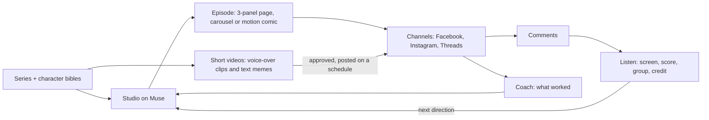
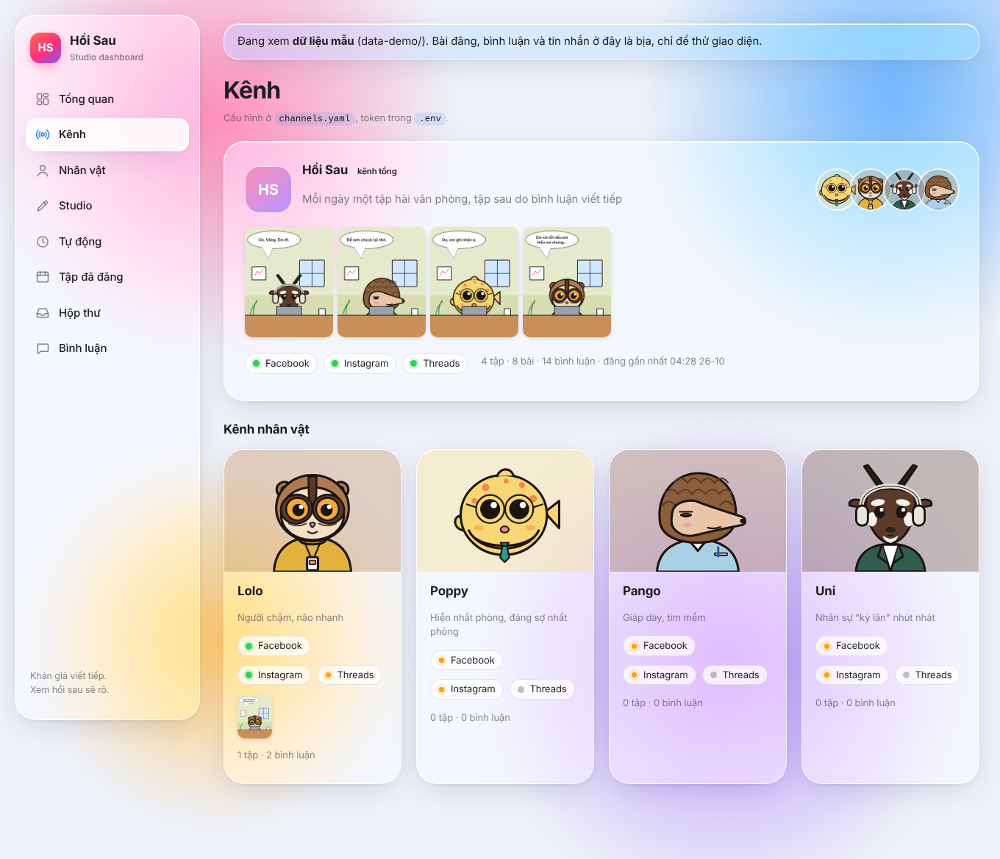
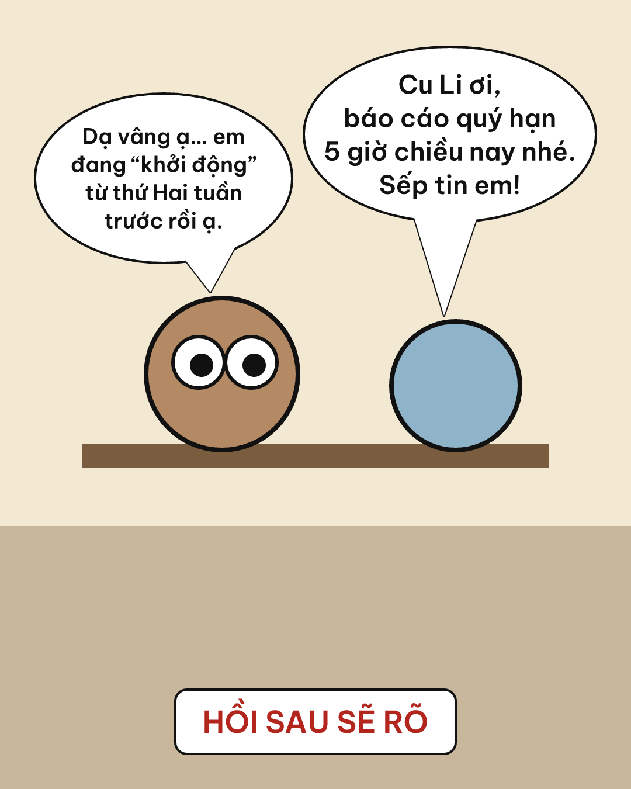
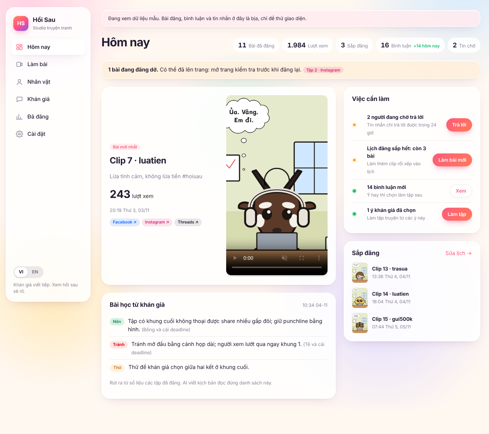

# Hồi Sau

> *"Muốn biết sự thể ra sao, xem hồi sau sẽ rõ."* (Want to know what happens? See the next chapter.) Here, the audience writes that next chapter.

**Hồi Sau** runs original AI characters as a daily office-comedy comic for young Vietnamese office workers. Meta's Muse models write, draw and check every episode, and the same characters star in two short 9:16 clips a day. Episodes and clips go out on Facebook, Instagram, Threads and TikTok, and the comments under them decide what happens next.

Meta Global AI Developer Hackathon 2026 · Indie Developer track · *Build for Your World*.

| | |
| --- | --- |
| Demo video | *link added on 4 Nov* |
| Live series | [Facebook](https://www.facebook.com/profile.php?id=61595845893958) · [Instagram @hoisau.comic](https://www.instagram.com/hoisau.comic/) · [Threads @hoisau.comic](https://www.threads.net/@hoisau.comic) · [TikTok @hoisau.comic](https://www.tiktok.com/@hoisau.comic) · [X @hoisaucomic](https://x.com/hoisaucomic) · episodes at [hoisau.dangtrantai.com](https://hoisau.dangtrantai.com) |
| How it is built | [docs/architecture.md](docs/architecture.md) · [docs/studio-pipeline.md](docs/studio-pipeline.md) |
| Where each Meta tool is used | [docs/meta-tools.md](docs/meta-tools.md) |
| Results | [docs/metrics.md](docs/metrics.md) |
| Short videos and scheduled posting | [docs/short-videos.md](docs/short-videos.md) |
| Daily build log | [docs/build-log.md](docs/build-log.md) |

## Why this exists

Young office workers in Vietnam share relatable workplace jokes every day, and a recurring character is the format that builds a following. A character that posts daily is a full-time job by hand, and producing one with AI in bulk now gets demonetized: since July 2025 both YouTube and Meta have tightened monetization of mass-produced, unoriginal content.

Hồi Sau goes the other way. The characters, their world and their rules are written by a person and enforced on every panel. Every episode is new and serialized, because the writer remembers what happened. And the audience co-writes it: comments are not a vanity metric here, they are tomorrow's input. The same studio can later run a brand's mascot, which gives it a B2B path next to the channels' own revenue.

## Built during the hackathon

Kickoff was **26 Oct 2026, 23:24 Hanoi time (16:24 UTC)**. Every commit in this repository is from after kickoff, and [docs/build-log.md](docs/build-log.md) records the work day by day.

### Pre-existing work

No earlier product, library or codebase of ours is used.

Before kickoff we wrote planning documents: the idea, an architecture sketch and a schedule. They are not in this repository. One planning note is in the repository, [docs/meta-integration-notes.md](docs/meta-integration-notes.md), about the Facebook and Instagram APIs, and we declare it here.

Earlier on 26 Oct, before kickoff, we also made an empty workspace scaffold and a first prototype of the Facebook/Instagram publisher in a different repository. Neither is in this repository. The workspace setup and `packages/channel` here were written again from scratch after kickoff.

Dependencies: only public open-source packages from npm and PyPI, declared in the package files. None of them is earlier work of ours.

## How it works

The loop has two halves.

1. **Studio** (`packages/studio`) works the way a small comic studio does. A series bible and a character bible say who everyone is, and a locked model sheet fixes how each character looks. Each episode is made in steps that can be rerun one at a time: premise, beats, panel script, storyboard, panels drawn by Muse Image against the model sheets, a Muse Spark review that sends off-model panels back for a targeted redraw, Vietnamese lettering as an SVG layer, and finally canon memory for later episodes. See [docs/studio-pipeline.md](docs/studio-pipeline.md).
2. **Channels and listening** (`packages/channel`, `packages/story`) post the episode for each brand, pull the comments back, screen and score them, and group them by idea. The editor picks the next direction, and the commenter behind it shows up in a later episode as a coworker.



### Channels: one series, a brand per character

Hồi Sau is the main channel and posts every episode. Each character is also a brand of its own, with its own Facebook Page, Instagram and Threads, and posts the episodes it leads. [channels.yaml](channels.yaml) lists the brands, the status of each channel (`live`, `paused`, `planned`) and the **names** of the `.env` variables that hold its ids and tokens. During the contest only Hồi Sau and Lolo are live; the other five are set up and paused.

```bash
npm run channel -- brands                               # every brand and channel, and which .env names are empty
npm run channel -- setup <token> --brand lolo           # connect Lolo's Page and Instagram
npm run channel -- publish episodes/ep-001/post.json    # Hồi Sau, plus the lead's brand if it is live
npm run channel -- publish post.json --brand poppy instagram   # one brand and platform by hand
```

`post.json` carries `lead` (and optionally `characters`); without them the post goes to Hồi Sau only. Each brand has its own journal entries, so one episode can be on several Pages without being posted twice to any of them. The dashboard's **Cài đặt → Kênh** tab lists the brands, then each brand's accounts, posts and comments.



### Meta models

| Job | Model |
| --- | --- |
| Character bible, premise, beats, panel script, storyboard, canon, recap | Muse Spark |
| Script safety gate before drawing | Muse Spark + rules |
| Panel review against the model sheet; reading reference images | Muse Spark (vision) |
| Series style, model and pose sheets, brand art, panels, single-detail redraws | Muse Image |
| Scoring comments, character replies | Muse Spark Open (open weights, on Baseten or Modal; Muse Spark until hosting is set) |
| Coach lessons from what worked | Muse Spark |
| Short videos: what each shot shows, the second pose, the bubble; title and caption; the shots of a text meme from its two lines | Muse Spark |
| Short videos: one full-frame picture per shot, a second pose, a shut and an open mouth | Muse Image |
| Short videos: checks each picture (on-model, drawn once, no stray text, fills the 9:16 frame) | Muse Spark (vision) |
| Short videos: reads a note on what is wrong and proposes the edits; finds the thing to fix; compares the picture before and after a fix | Muse Spark (vision) |
| Short videos: from pasted text or up to four pictures, reads every word and proposes a text clip or a one-panel comic with our cast | Muse Spark (vision) |
| Short videos: the character in both poses so the background stays still; the mouth, nose and eyes; the region of a detail fix | SAM 3.1 |
| Trend dance clips (experiment): a person's pose in each frame | Keypoint R-CNN (Meta AI Research, open weights via torchvision, local) |
| Word times of the voice, for captions and the moving mouth | MMS-1B (`facebook/mms-1b-all`, open weights, local); Muse Voice Transcribe once the key can call it |
| Short videos: instrumental background music | MusicGen (`facebook/musicgen-small`, open weights, local) |
| A character's own voice, when a video needs one | MMS-TTS (`facebook/mms-tts-vie`, plus our Hà Nội fine-tune) or SeamlessM4T v2, open weights, local |
| Publishing, comments, inbox, insights | Facebook Pages API, Instagram Graph API, Threads API, Messenger Platform |

Every call by step, with its command and file: [docs/meta-tools.md](docs/meta-tools.md).

**Meta models only.** Every model the product calls is Meta's: the Muse models and SAM 3.1 through the Meta Model API, and Meta open weights (Muse Spark Open, MMS-1B, MMS-TTS, SeamlessM4T v2, MusicGen) on our own machine or on Baseten/Modal. No third-party AI service is used. Tools that are not models (ffmpeg, open-licensed fonts) are listed in [docs/meta-tools.md](docs/meta-tools.md).

### Vietnamese text layer

Image models distort Vietnamese diacritics, so Muse Image draws panels **with no text** and the dialogue (and, if needed, the bubble itself) is composited on top as an SVG layer with an open-licensed font, Be Vietnam Pro. Lines break only between syllables and are fitted to the bubble shape with the font's real metrics. Editing a line never requires redrawing a panel, and an English edition is a text swap. See [packages/svg-text](packages/svg-text).



## Repository layout

| Path | What is there |
| --- | --- |
| `packages/studio` | Characters, series bible, the episode pipeline on Muse |
| `packages/svg-text` | Vietnamese dialogue fitted into speech bubbles as SVG |
| `packages/story` | Listening to comments, story memory, the coach |
| `packages/channel` | Facebook, Instagram and Threads per brand: publishing, comments, inbox |
| `packages/dashboard` | One web screen over all of it |
| `packages/motion` | Lettered episode → 9:16 motion comic (ffmpeg) for Reels and Threads |
| `packages/pipeline` | The daily loop: comments → episode → motion comic → posts, with a scheduler |
| `packages/dance` | Experiment: a person dancing in a clip becomes one of our characters dancing the same moves (Muse Image, SAM 3.1, Keypoint R-CNN) |
| `packages/talk` | Short 9:16 videos: illustrated voice-over (one picture per shot, two poses, optional moving mouth), text memes (two beats of text, MusicGen music), TikTok covers, talking to camera, lip-sync |
| `scripts/` | Site build, Windows scheduled tasks: the daily episode, and posting approved clips at set times |
| `characters/`, `series/` | Character profiles and portraits; series bible and style |
| `channels.yaml` | Brands (Hồi Sau plus one per character) and their accounts |
| `docs/` | Architecture, pipeline plan, Meta tools, metrics, demo script, submission draft, integration notes, build log |

## The cast

Six lesser-known Vietnamese animals share one office. Each has a want, a fear, a contradiction, a life outside the joke, a comic engine tied to the animal's body and an `edge`, a rebellious or weird side kept for the twist. Names are rarely said in dialogue, so the situation and the drawing carry the joke. The four teammates compete on the same script; the winner is chosen by share, save and comment rate, not taste. Each has an English name and a Vietnamese one (`name_vi`).

| Character | Office type |
| --- | --- |
| [Lolo / Tũn](characters/cu-li/profile.yaml) (slow loris) | Slow hands, fast-spiralling mind; wants the boss to say her name right once |
| [Poppy / Bống](characters/ca-noc/profile.yaml) (pufferfish) | The gentlest accountant, who grows a size with every swallowed complaint; leaves at 17:00 to pick up her four-year-old |
| [Pango / Tê](characters/te-te/profile.yaml) (pangolin) | Team lead whom criticism slides off; curls into a ball to shield his team |
| [Uni / Sa](characters/sao-la/profile.yaml) (saola, the "Asian unicorn") | The hyped "unicorn" hire who vanishes whenever she's praised |
| [Bino / Mực](characters/cay-muc/profile.yaml) (binturong) | The director on the 8th floor, with a walrus moustache, a suit and a white cat, Tuyết, who may really run the company |
| [Rico / Lẻo](characters/chon-bac-ma/profile.yaml) (ferret-badger) | The rival team lead who flatters and steals credit; never insults anyone, and every scheme backfires |

Each character also has a placeholder portrait (`characters/<slug>/portrait.svg`, flat 2D drawn by hand for this repo). Offline runs draw their panels and sheets from these portraits, and the dashboard shows them until a Muse Image model sheet is locked. Real runs never use them.



## Getting started

Node.js 20 or newer.

```bash
npm install
cp .env.example .env   # then fill in META_API_KEY
npm test

npm run studio -- characters             # validate the character profiles
npm run studio -- sheet all --mock       # character consistency test, offline
npm run studio -- sheet cu-li            # the same against Muse Image
npm run studio -- character new "một con vượn làm thiết kế" --mock   # idea → character bible
npm run studio -- episode new ep-001 --lead cu-li --with ca-noc --direction "Cu Li nhận việc gấp lúc 4h50"
npm run studio -- episode run ep-001 --mock   # premise → … → lettered pages in episodes/ep-001/final/
npm run demo -w @hoi-sau/svg-text        # letter a sample panel in Vietnamese
npm run dashboard -- --demo              # dashboard with sample data on http://localhost:4321
npm run motion -- episode ep-001 --draft # motion comic in episodes/ep-001/motion/reel.mp4 (needs ffmpeg)
npm run pipeline -- run --mock           # one whole day offline: comments → episode → video → posts, in data-demo/
npm run talk -- demo                     # a short talking clip offline, mock pictures and a hummed voice
npm run talk -- meme cu-li --out data/video/meme-1   # text meme from data/video/meme-1/meme.json (needs ffmpeg, Python for MusicGen)
npm run talk -- illustrate cu-li clips/sample.mp4    # illustrated voice-over from a sample clip
```

### Public site and media

Instagram and Threads fetch media from a public HTTPS URL, so finished episodes
go to Firebase Hosting (`firebase.json`, `site/public/`). The dashboard runs on
Cloud Run, as an open demo with sample data and a password-protected admin: see
[docs/cloud.md](docs/cloud.md).

```bash
npm run site -- add ep-001    # episodes/ep-001/final → site/public/media/ep-001/*.jpg
npm run site -- deploy        # firebase deploy --only hosting
```

An episode post can then list `"mediaUrls": ["ep-001/01.jpg", …]`; relative
paths are read under `MEDIA_BASE_URL`.

## Status

Running for real since 27 Oct:

- **Daily comic** on the Hồi Sau Facebook Page, Instagram and Threads, made with the full Muse episode pipeline (offline mock included), Vietnamese lettering, story memory and canon from the published episodes, and the safety gate. Nothing is posted until the owner approves the exact files.
- **Short videos** from the dashboard's **Làm bài → Video** screen: illustrated voice-over clips and text memes, checked shot by shot, fixed by a plain-language note with before/after evidence (**Sửa bằng lời**), with MusicGen music, TikTok covers and the [/tai](https://hoisau.web.app/tai) download page. A **Làm từ chữ hoặc ảnh** box turns pasted text or up to four pictures into a proposed text clip or one-panel comic. Approved clips post at the times in a plan file through Windows scheduled tasks, so nobody has to be at the keyboard; the **Lịch đăng** tab shows and edits that schedule. Standing instructions ("short captions", "office by default"…) live in **Luật nhà** and every prompt reads them. See [docs/short-videos.md](docs/short-videos.md).
- **TikTok**: videos and photo episodes go to the app's drafts (Sandbox; Production in review), or are posted by hand from /tai.
- **Listening**: comments are screened, scored and grouped; replies and the coach's lessons wait for approval.
- **Backups** from the dashboard of everything that lives only on the owner's machine (comments, journal, episodes, story memory, character sheets), the last 3 kept, skipping what videos can make again and never filling the drive; `.env` is never copied.

Not done yet: direct posting to TikTok until the app passes its audit, and a character voice good enough to ship (the Hà Nội MMS-TTS fine-tune is close but not there, so clips use original sound or music). Day-by-day progress is in [docs/build-log.md](docs/build-log.md).

## License

[MIT](LICENSE)
