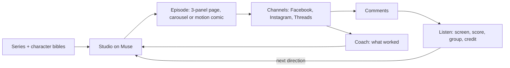
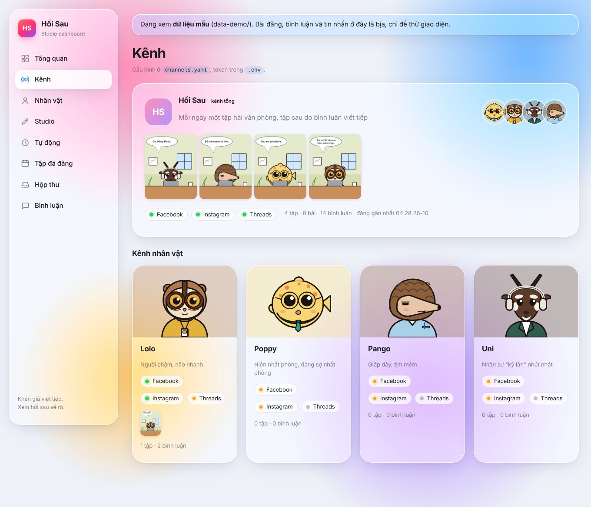
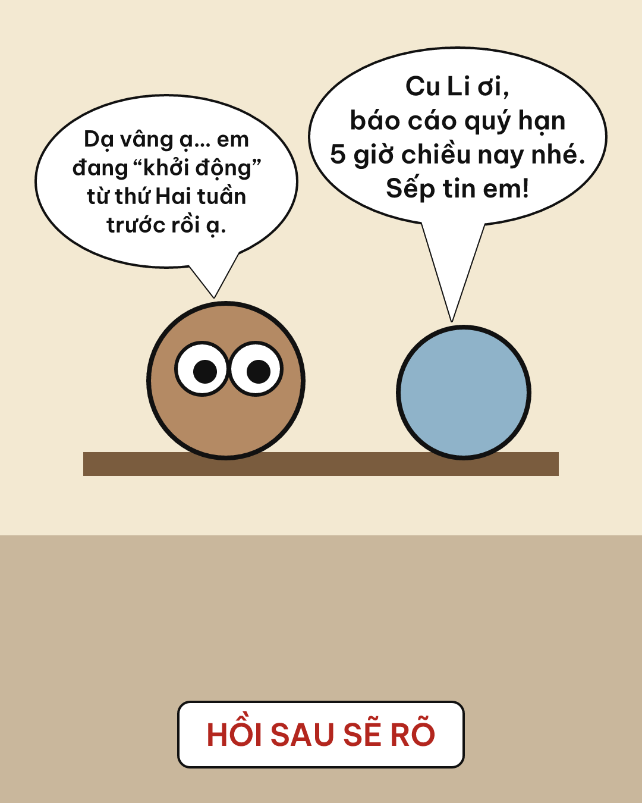
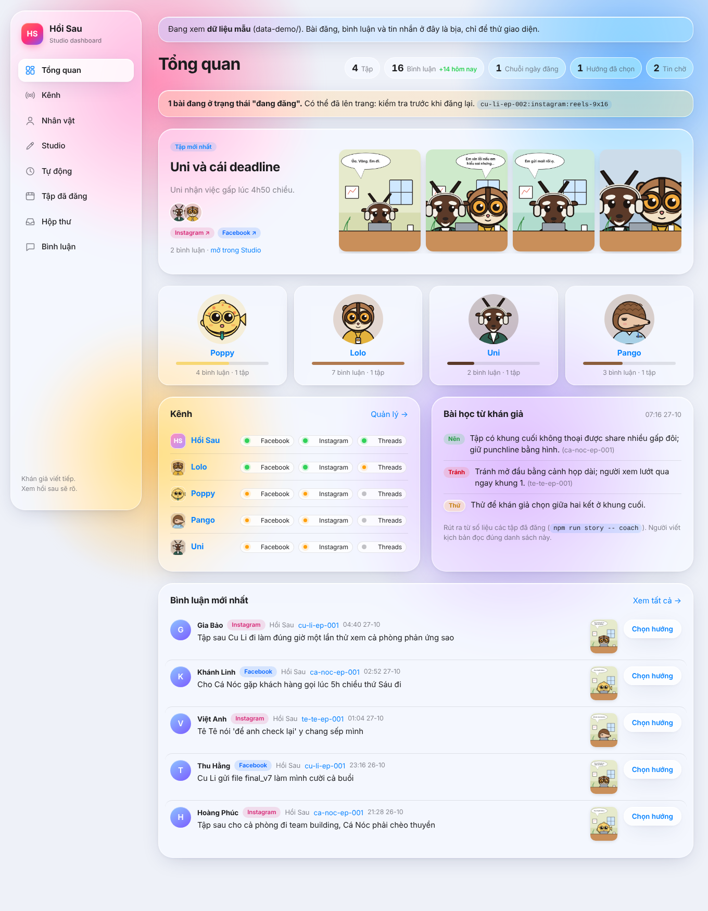

# Hồi Sau

> *"Muốn biết sự thể ra sao, xem hồi sau sẽ rõ."* (Want to know what happens? See the next chapter.) Here, the audience writes that next chapter.

**Hồi Sau** runs original AI characters as a daily office-comedy comic for young Vietnamese office workers. Meta's Muse models write, draw and check every episode. The episode goes out on Facebook, Instagram and Threads, and the comments under it decide what happens next.

Meta Global AI Developer Hackathon 2026 · Indie Developer track · *Build for Your World*.

## Built during the hackathon

Kickoff was **26 Oct 2026, 23:24 Hanoi time (16:24 UTC)**. Every commit in this repository is from after kickoff, and [docs/build-log.md](docs/build-log.md) records the work day by day.

### Pre-existing work

No earlier product, library or codebase of ours is used.

Before kickoff we wrote planning documents: the idea, an architecture sketch and a schedule. They are not in this repository. One planning note is in the repository, [docs/meta-integration-notes.md](docs/meta-integration-notes.md), about the Facebook and Instagram APIs, and we declare it here.

Earlier on 26 Oct, before kickoff, we also made an empty workspace scaffold and a first prototype of the Facebook/Instagram publisher in a different repository. Neither is in this repository. The workspace setup and `packages/channel` here were written again from scratch after kickoff.

## How it works

The loop has two halves.

1. **Studio** (`packages/studio`) works the way a small comic studio does. A series bible and a character bible say who everyone is, and a locked model sheet fixes how each character looks. Each episode is made in steps that can be rerun one at a time: premise, beats, panel script, storyboard, panels drawn by Muse Image against the model sheets, a Muse Spark review that sends off-model panels back for a targeted redraw, Vietnamese lettering as an SVG layer, and finally canon memory for later episodes. See [docs/studio-pipeline.md](docs/studio-pipeline.md).
2. **Channels and listening** (`packages/channel`, `packages/story`) post the episode for each brand, pull the comments back, screen and score them, and group them by idea. The editor picks the next direction, and the commenter behind it shows up in a later episode as a coworker.



### Channels: one series, a brand per character

Hồi Sau is the main channel and posts every episode. Each character is also a brand of its own, with its own Facebook Page, Instagram and Threads, and posts the episodes it leads. [channels.yaml](channels.yaml) lists the brands, the status of each channel (`live`, `paused`, `planned`) and the **names** of the `.env` variables that hold its ids and tokens. During the contest only Hồi Sau and Lolo are live; the other three are set up and paused.

```bash
npm run channel -- brands                               # every brand and channel, and which .env names are empty
npm run channel -- setup <token> --brand lolo           # connect Lolo's Page and Instagram
npm run channel -- publish episodes/ep-001/post.json    # Hồi Sau, plus the lead's brand if it is live
npm run channel -- publish post.json --brand poppy instagram   # one brand and platform by hand
```

`post.json` carries `lead` (and optionally `characters`); without them the post goes to Hồi Sau only. Each brand has its own journal entries, so one episode can be on several Pages without being posted twice to any of them. The dashboard's **Kênh** page lists the brands, then each brand's accounts, posts and comments.



### Meta models

| Job | Model |
| --- | --- |
| Character bible, premise, beats, panel script, storyboard, canon | Muse Spark |
| Panel review against the model sheet | Muse Spark (vision) |
| Model sheets, panels, single-detail redraws | Muse Image |
| Scoring and grouping comments at volume | Muse Spark Open (open weights, on Baseten or Modal) |

### Vietnamese text layer

Image models distort Vietnamese diacritics, so Muse Image draws panels **with no text** and the dialogue (and, if needed, the bubble itself) is composited on top as an SVG layer with an open-licensed font, Be Vietnam Pro. Lines break only between syllables and are fitted to the bubble shape with the font's real metrics. Editing a line never requires redrawing a panel, and an English edition is a text swap. See [packages/svg-text](packages/svg-text).



## Repository layout

| Path | What is there |
| --- | --- |
| `packages/studio` | Characters, series bible, the episode pipeline on Muse |
| `packages/svg-text` | Vietnamese dialogue fitted into speech bubbles as SVG |
| `packages/story` | Listening to comments, story memory, the coach |
| `packages/channel` | Facebook, Instagram and Threads per brand: publishing, comments, inbox |
| `packages/dashboard` | One web screen over all of it |
| `characters/`, `series/` | Character profiles and portraits; series bible and style |
| `channels.yaml` | Brands (Hồi Sau plus one per character) and their accounts |
| `docs/` | Pipeline plan, integration notes, build log |

## Test characters

Four lesser-known Vietnamese animals work in the same team. Each has a want, a fear, a contradiction, a life outside the joke and a comic engine tied to the animal's body; names are rarely said in dialogue, so the situation and the drawing carry the joke. They compete on the same script; the winner is chosen by share, save and comment rate, not taste.

| Character | Office type |
| --- | --- |
| [Lolo](characters/cu-li/profile.yaml) (slow loris) | Slow hands, fast-spiralling mind; wants the boss to say her name right once |
| [Poppy](characters/ca-noc/profile.yaml) (pufferfish) | The gentlest accountant, who grows a size with every swallowed complaint; leaves at 17:00 to pick up her four-year-old |
| [Pango](characters/te-te/profile.yaml) (pangolin) | Team lead whom criticism slides off; curls into a ball to shield his team |
| [Uni](characters/sao-la/profile.yaml) (saola, the "Asian unicorn") | The hyped "unicorn" hire who vanishes whenever she's praised |

Each character also has a placeholder portrait (`characters/<slug>/portrait.svg`, flat 2D drawn by hand for this repo). Offline runs draw their panels and sheets from these portraits, and the dashboard shows them until a Muse Image model sheet is locked. Real runs never use them.



## Getting started

Node.js 20 or newer.

```bash
npm install
cp .env.example .env   # then fill in META_API_KEY
npm test

npm run studio -- characters             # validate the character profiles
npm run studio -- sheet all --mock       # character consistency test, offline
npm run studio -- sheet cu-li            # the same against Muse Image
npm run studio -- character new "một con vượn làm thiết kế" --mock   # idea → character bible
npm run studio -- episode new ep-001 --lead cu-li --with ca-noc --direction "Cu Li nhận việc gấp lúc 4h50"
npm run studio -- episode run ep-001 --mock   # premise → … → lettered pages in episodes/ep-001/final/
npm run demo -w @hoi-sau/svg-text        # letter a sample panel in Vietnamese
npm run dashboard -- --demo              # dashboard with sample data on http://localhost:4321
```

### Public site and media

Instagram and Threads fetch media from a public HTTPS URL, so finished episodes
go to Firebase Hosting (`firebase.json`, `site/public/`). The dashboard runs on
Cloud Run, as an open demo with sample data and a password-protected admin: see
[docs/cloud.md](docs/cloud.md).

```bash
npm run site -- add ep-001    # episodes/ep-001/final → site/public/media/ep-001/*.jpg
npm run site -- deploy        # firebase deploy --only hosting
```

An episode post can then list `"mediaUrls": ["ep-001/01.jpg", …]`; relative
paths are read under `MEDIA_BASE_URL`.

## Status

In place: character creation, series bible, the full Muse episode pipeline (with an offline mock), Vietnamese lettering, listening and story memory, the dashboard, and publishing, comments and inbox for every brand. Day-by-day progress is in [docs/build-log.md](docs/build-log.md).
