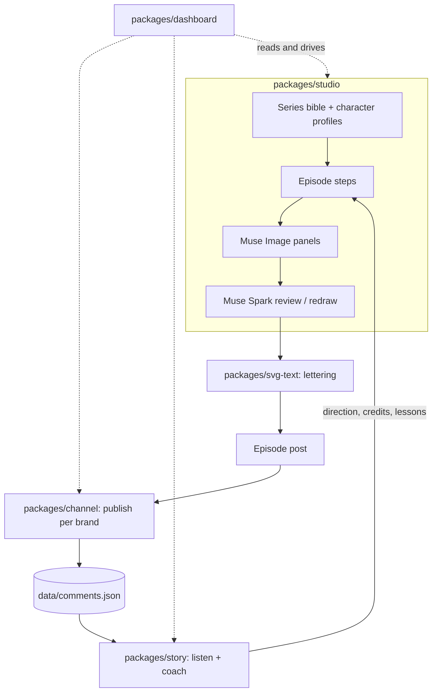

# Architecture

Hồi Sau is a set of small TypeScript packages in one npm workspace. They talk through files on disk (YAML for bibles and profiles, JSON for each step's output), so every step can be inspected, edited by hand and rerun on its own.

## Packages

| Package | Owns | Main files on disk |
| --- | --- | --- |
| `studio` | Character creation, model sheets, series bible, the episode pipeline | `characters/<slug>/profile.yaml`, `series/bible.yaml`, `episodes/<id>/*.json`, panels |
| `svg-text` | Fitting Vietnamese dialogue into bubbles with real font metrics; PNG export | none (pure functions) |
| `story` | Comment screening and scoring, idea clusters, credits, story memory, the coach | `data/listen/*.json`, `series/memory.yaml` |
| `channel` | Accounts per brand, publishing, comments, inbox | `channels.yaml`, `.env`, `data/publish-journal.json`, `data/comments.json`, `data/inbox.json` |
| `dashboard` | A local web UI over the files above | none of its own |

The episode steps and their inputs and outputs are listed in [studio-pipeline.md](studio-pipeline.md).

## Models

Writing and review use Muse Spark through the Meta Model API with strict JSON schemas. Drawing uses Muse Image on the Responses API, chaining turns so the model keeps the sheet and earlier panels in context. Comment scoring uses Muse Spark Open on an OpenAI-compatible host (Baseten or Modal), and falls back to Muse Spark. Every model client has an offline mock, so the whole loop runs and is tested without keys.

## Channels

`channels.yaml` lists brands: Hồi Sau, which posts every episode, plus one brand per character, which posts the episodes it leads. Each channel is `live`, `paused` or `planned`, and the file holds only the **names** of the `.env` variables with ids and tokens. The Meta app stays in Development mode, so our own Pages and accounts work without App Review. See [meta-integration-notes.md](meta-integration-notes.md).

## Safety rules that cut across packages

- Commenters are credited by name only and drawn from a text description, never from a real photo.
- Comments written by our own accounts never count as votes.
- Tokens stay in `.env` (git-ignored) and in request headers, never in URLs or logs.
- A publish journal prevents posting the same episode twice to the same account.
