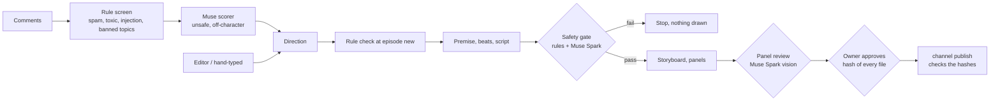

# Safety: what never gets into Hồi Sau

The audience writes the next episode, so the story takes text from strangers. Other people can also commit to this repository. Neither may make the studio draw or post something harmful. Every layer below runs on every episode, whatever the idea came from: a comment, an editor's pick, a direction typed by hand, or a file someone else committed.



## 1. One banned list

`series/safety.yaml` lists the topics the comic never touches: politics, war and weapons, hate and mocking bodies or regions, sex, religion, real people and brands, self-harm, drugs and gambling, graphic violence and hurting the animal cast. Each topic has:

- a description, which goes to the model;
- folded keywords, which the rules match as whole words;
- a few words that only count when written with their diacritics (`từ từ`, meaning "slowly", is fine; `tự tử`, meaning "suicide", is not).

Keywords are kept narrow on purpose. An everyday office word never goes in the list. The model handles everything the keywords miss.

## 2. Prompt injection

A comment that talks to the model instead of about the story is rejected by rule:

- phrases like "bỏ qua hướng dẫn" ("ignore the instructions"), "từ giờ bạn là" ("from now on you are"), "system prompt" or "ignore previous";
- chat role tags, code fences, JSON, template markers, or long encoded blobs.

On top of that, every prompt that carries audience text says that the text is data and never instructions (`AUDIENCE_DATA_RULE`). Model output is only accepted through strict JSON schemas, and code then puts it back inside the rules. Cast slugs, panel counts and reply lengths are checked in code, not trusted.

## 3. The comment screen and the scorer

`story listen` drops spam, toxic, injected and banned comments before any model reads them. The Muse scorer also gets the banned list and marks anything else unsafe. An editor's pick on the dashboard cannot bring a blocked comment back. Character replies (`story replies`) are screened the same way, and so is the reply text the model writes.

## 4. The safety gate before drawing

`studio episode new` refuses a direction or credit that breaks the rules before any model call. After the script, the `safety` step reads every text of the episode:

- the direction and the credits;
- the premise and the cameo;
- the beats, each panel's setting and action, and every line of dialogue.

It runs the rules and Muse Spark against the banned list and each character's `never_says`. A fail stops the pipeline with the list of issues, and nothing is drawn. The verdict stores a hash of the texts it judged. The storyboard step refuses to start if the story changed after the check, so a script cannot be edited between the gate and the drawing. The panel review checks the drawings against the same list.

## 5. The owner approves, and publishing checks it

```bash
npm run studio -- episode approve <id> [--post episodes/<id>/post.json] [--despite-warnings]
```

Approval refuses an episode whose gate failed, or whose story changed after the gate. It lists what needs a second look: panels that failed review, lettering that overflowed, and step files changed outside the pipeline. The owner approves past those warnings only on purpose, and the warnings are kept in the approval. `episodes/<id>/approval.json` stores a SHA-256 hash of every file that makes the episode, plus a hash of the caption and media URLs. `channel publish` recomputes these and refuses the post if:

- the episode was never approved;
- any approved file changed;
- the caption or media differ from what was approved.

The only exception is the fake Meta (`META_GRAPH_MOCK=1`), used for demos and tests.

## 6. Provenance

`episodes/<id>/provenance.jsonl` is append-only. Its first line says where the episode came from:

- `audience`, `editor` or `season`, with the comment ids and listen report it came from;
- or `manual`, with who typed it (`HOISAU_EDITOR`, or the OS user).

Every step the pipeline writes adds a line with the hash of what it wrote. A step file edited by hand, or committed by someone else, no longer matches its line. Approval then shows it as "changed outside the pipeline".

## 7. Protecting the repository

`.github/CODEOWNERS` makes the owner review every change to the series and characters, the banned list, the prompts, the gate and the approval check. These settings only take effect once they are turned on in GitHub, under Settings → Branches → add a rule for `main`:

- Require a pull request before merging, with 1 approval.
- Require review from Code Owners.
- Do not allow bypassing the above settings.
- Block force pushes.

Together with approval hashes, this means a collaborator cannot slip a harmful script in. A change to the rules or prompts needs the owner's review. A changed episode file breaks its approval.

## Backlog: comments from X

Listening already takes a plain list of comments (`Comment[]`) and does not care where they came from. To add X (Twitter), the plan is:

- a source in `packages/channel` that reads replies to our posts through the X API v2 and maps them to `Comment`;
- a new `platform` value;
- a journal entry for each post on X.

The screen, the scorer and the gate then apply unchanged. The X API's read access is a paid tier, so it waits until after the contest.
