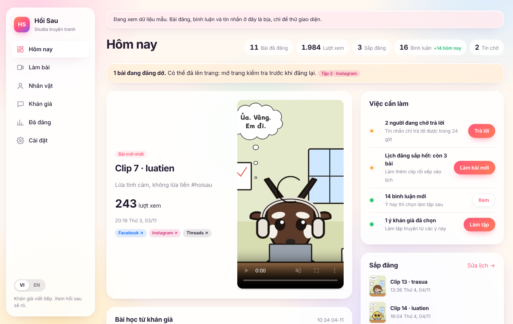

# @hoi-sau/dashboard

One screen for the whole loop: episodes published, comments pulled back, the direction picked for the next episode, and how the characters compare.



```bash
npm run dashboard -- --demo   # sample data in data-demo/, opens on http://localhost:4321
npm run dashboard             # real data from CHANNEL_DATA_DIR (default data/)
```

The menu has six places, each with tabs along the top:

- **Hôm nay** (Today): only what needs doing now (not connected, low disk, messages waiting, videos to review, schedule running out, new comments, picked ideas), then the latest post with its views and links, what posts next, and the audience lessons. When nothing is urgent it says so.
- **Làm bài** (Make): **Video** (make, check and fix short clips, see below) and **Truyện tranh** (the comic Studio, one panel by default).
- **Nhân vật** (Characters): profiles and model sheets, plus **Nét vẽ** (art style).
- **Khán giả** (Audience): **Bình luận** (search, filter, "Chọn hướng" to pick a comment as the next episode's direction, saved to `directions.json`) and **Tin nhắn** (Messenger and Instagram DMs with Meta's 24-hour reply countdown; replies go out through the Send API with `messaging_type=RESPONSE`).
- **Đã đăng** (Posted): **Bài đã đăng** (one card per post across platforms, its Threads still folded in, total views on the cover), **Lịch đăng** and **Hiệu suất** (views and engagement by post and by hour).
- **Cài đặt** (Settings): **Kết nối** (app keys, backups), **Kênh** (brands and accounts), **Luật nhà**, **Tư liệu** (moodboard) and **Tự động** (pipeline runs).

It reads the same files the channel and studio CLIs write and re-reads them on every request, so a refresh shows the latest pull. No database, no client framework: Node's `http` server and server-rendered HTML.

## For people, not coders

Everything is done from buttons; no commands, file names or setting names appear on screen.

- **Vietnamese / English** switch at the bottom of the menu (remembered in a cookie).
- **Bright, fluid layout:** full width on wide screens, icon sidebar on laptops, top bar with a menu on phones.
- **Settings:** paste the app keys once; they are written to `.env` and only ever shown as "set" / "missing".
- **Channels → Kết nối Facebook:** logs in through Facebook in the browser, picks the Page (and its Instagram), and saves the Page token. Threads takes a pasted token. Each account has Pause / Turn on, written back to `channels.yaml` with its comments kept.
- **Lấy bình luận mới / Lấy tin nhắn mới** pull comments and messages with a button.
- **Characters:** create with the AI or by hand, and edit any profile in a form (palette swatches, voice, never-says, inner life); the YAML keeps its comments. "Vẽ model sheet" draws the sheet with Muse Image. In English the profile's Vietnamese prose (role, inner life, comic situations, personality, catchphrases, never-says) is shown from `characters/<slug>/profile.en.json`, a map from each Vietnamese line to its English; a line edited since then has no match and shows as written.

Known gap: behind Firebase Hosting only the `__session` cookie is forwarded, so the language choice does not stick there yet.

## Studio

- **Nhân vật → Tạo nhân vật**: one line of idea, and Muse Spark writes the full profile into `characters/<slug>/`.
- **Khoá model sheet** on a character page: locks the latest `studio sheet` render as the reference every panel is drawn against.
- **Truyện tranh** (Studio): one panel by default (three-panel strip and page still offered); creates an episode from the picked comments (direction plus credits), runs the steps in the background, and shows each step's output (premise, beats, script, storyboard, panels, review with before/after, lettered pages, canon), with "Chạy lại từ đây" (rerun from here) on every step.

- **Sửa bằng lời** on a finished episode: write what is wrong (a bubble's words, one thing in a picture, or a whole panel to redraw). Muse Spark reads the note against the script and the finished panels and lists what it will change; nothing changes until you press Làm. New words pass the safety check again before lettering, a picture change is an edit of that panel only, and the page then shows each changed panel before and after, with Giữ or Hoàn tác. A fixed episode needs approving again.

In `--demo`, Studio works on copies in `data-demo/studio/`, uses the offline Muse mock, and starts with one finished sample episode.

## Video

- **One box** at the top of Video, like a chat message: write the idea, optionally attach pictures or a clip (or pick a sample clip). A clip starts an illustrated voice-over at once, lead taken from a character named in the note (Tũn otherwise). Text or pictures go to Muse Spark, which proposes a text clip or a one-panel comic with every field filled in; the fields stay folded unless you open them, and nothing is made until you press the button.
- **A clip's page** shows one "Bước tiếp" (next step) card at the top: look over the scenes (one button, "Cảnh nào cũng ổn, dựng video", ticks every scene and renders), then watch and approve, then post. A scene that is wrong gets Báo lỗi on its own card, or **Sửa bằng lời** under the video (before/after, a zoom and a changed-pixel map, keep or undo). The approval form shows the caption and the time; version, TikTok cover and Threads options are folded, already filled in. Approving makes the TikTok cover and the /tai download page. See [docs/short-videos.md](../../docs/short-videos.md).

## Lịch đăng (posting schedule)

Approved clips post from Windows scheduled tasks (`\HoiSau\`, one per clip, running `scripts/post-clip.ps1` in the hoi-sau-story checkout), so the dashboard does not have to stay open. The **Lịch đăng** tab reads those tasks and shows each clip with its cover, caption and time. Change a time, drop a clip, add approved clips that are not scheduled yet, or "Xếp lại giờ ngẫu nhiên" (3–5 a day by default, 7:00–23:00 Hanoi, at least two hours apart), then "Lưu lịch": it writes `data/post-plan.txt`, runs `schedule-posts.ps1 -Plan` and only after that succeeds removes tasks of clips no longer in the plan. Each post opens (**Xem bài**) to its video, the whole caption, Tải video / Tải ảnh bìa buttons (served by the dashboard as downloads) and the phone QR for that clip. A task it cannot read makes the page read-only. Off Windows (and in `--demo`) it edits the plan file only. Clips made in the dashboard's own Video screen are listed there too, under their own heading: their time can be moved or cleared from the same page, and the dashboard posts them itself, so it has to stay open.

## Luật nhà (house rules)

Standing rules in the owner's words (caption, pictures, dialogue, video, posting), kept in `series/house-rules.json` and read by every writer, planner and fixer prompt (comic script, talk idea, illustrated plan, shot fixes), so a rule said once applies to every post after it. Add or remove them in **Cài đặt → Luật nhà**. In **Sửa bằng lời**, ticking "Áp dụng cho mọi bài từ giờ" also saves the note as a video rule. It ships with the rules the owner gave in chat during the build.

## Backups

Settings sets a backup folder. The dashboard copies what lives only on this machine (comments, inbox, publish journal, research images, drawn episodes, story memory, character folders) into a dated folder of plain copies, keeps the last 3, leaves out what videos can make again, and skips a run when the drive is low. `.env` is never copied.
