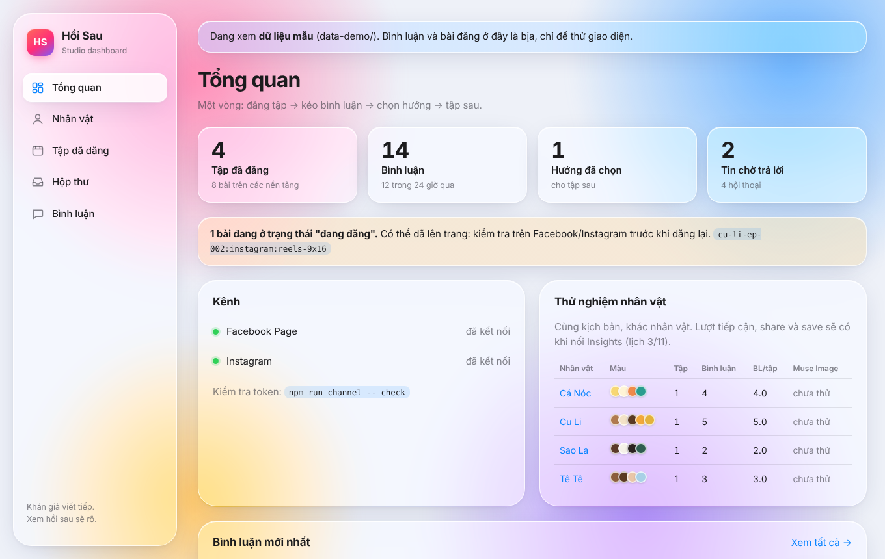

# @hoi-sau/dashboard

One screen for the whole loop: episodes published, comments pulled back, the direction picked for the next episode, and how the four test characters compare.



```bash
npm run dashboard -- --demo   # sample data in data-demo/, opens on http://localhost:4321
npm run dashboard             # real data from CHANNEL_DATA_DIR (default data/)
```

- **Overview:** episode, comment and picked-direction counts; Facebook / Instagram connection; posts stuck in "publishing" (they may already be live, so check before posting again); per-character comparison.
- **Characters:** profile, signature features, voice and never-says, and the latest Muse Image consistency run from `output/characters/<slug>/`.
- **Episodes:** the publish journal with links to each live post.
- **Inbox:** Messenger and Instagram direct messages side by side, with a countdown for Meta's 24-hour reply window. Replies go out through the Send API (`messaging_type=RESPONSE`); outside the window the composer is replaced by a note, so nothing fails on send. "Kéo tin mới" polls the Page's conversations (no webhook needed in Development mode).
- **Comments:** search (accent- and case-insensitive), filter by platform and episode, and "Chọn hướng" to pick a comment as the next episode's direction (saved to `directions.json`).

It reads the same files the channel and studio CLIs write and re-reads them on every request, so a refresh shows the latest pull. No database, no client framework: Node's `http` server and server-rendered HTML.

## For people, not coders

Everything is done from buttons; no commands, file names or setting names appear on screen.

- **Vietnamese / English** switch at the bottom of the menu (remembered in a cookie).
- **Bright, fluid layout:** full width on wide screens, icon sidebar on laptops, top bar with a menu on phones.
- **Settings:** paste the app keys once; they are written to `.env` and only ever shown as "set" / "missing".
- **Channels → Kết nối Facebook:** logs in through Facebook in the browser, picks the Page (and its Instagram), and saves the Page token. Threads takes a pasted token. Each account has Pause / Turn on, written back to `channels.yaml` with its comments kept.
- **Lấy bình luận mới / Lấy tin nhắn mới** pull comments and messages with a button.
- **Characters:** create with the AI or by hand, and edit any profile in a form (palette swatches, voice, never-says, inner life); the YAML keeps its comments. "Vẽ model sheet" draws the sheet with Muse Image.
- **Overview → Việc hôm nay:** the day's steps with a progress ring.

Known gap: behind Firebase Hosting only the `__session` cookie is forwarded, so the language choice does not stick there yet.

## Studio

- **Nhân vật → Tạo nhân vật**: one line of idea, and Muse Spark writes the full profile into `characters/<slug>/`.
- **Khoá model sheet** on a character page: locks the latest `studio sheet` render as the reference every panel is drawn against.
- **Studio**: creates an episode from the picked comments (direction plus credits), runs the steps in the background, and shows each step's output (premise, beats, script, storyboard, panels, review with before/after, lettered pages, canon), with "Chạy lại từ đây" (rerun from here) on every step.

In `--demo`, Studio works on copies in `data-demo/studio/`, uses the offline Muse mock, and starts with one finished sample episode.
