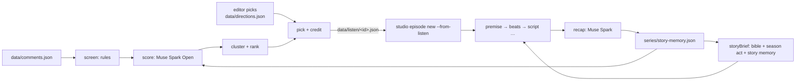

# @hoi-sau/story

The listening and memory side of the Studio: which comment becomes the next episode, and what the writer must remember when writing it.



## Listening

```bash
npm run story -- demo                         # 22 sample comments, offline, writes nothing
npm run channel -- comments                   # pull real comments into data/comments.json
npm run story -- listen [--lead cu-li] [--episode cu-li-ep-004] [--posts id,id]
npm run studio -- episode new cu-li-ep-004 --lead cu-li --from-listen data/listen/cu-li-ep-004.json
npm run studio -- episode run cu-li-ep-004
```

1. **Screen** (rules, no model). Rejects links, phone numbers and ad phrases (`inbox`, `giá sỉ`, `tuyển CTV`, `nhà cái`, …), profanity and regional slurs, emoji-only or tag-only comments, and duplicates (same author twice, or the same long text from several accounts). Matching runs on folded text, so `vl`/`vãi l` and `deadline trễ`/`deadline tre` match the same; the few words that are rude only with diacritics (`lồn`, `đéo`, …) match on the original, so `lớn`, `các`, `buổi họp` pass.
2. **Score** (Muse Spark Open on Baseten/Modal, else Muse Spark). Batches of 25. For each comment: `idea | reaction | question | off-character | unsafe`, the idea rewritten as one sentence, a cluster label, and `fun`, `fit` (in character and inside the current act), `fresh` (not a told episode) from 0 to 5. The model sees the lead's `never_says`, the series rules and the season act; it never sees author names. A reply that is not valid JSON, or skips comments, gets one repair turn.
3. **Cluster.** Same label, or ideas sharing at least half their words.
4. **Rank.** `quality × (1 + log2(1 + distinct authors)) + 0.5 × log2(1 + replies)`, where quality is the mean of the top three comments (`0.4 fun + 0.4 fit + 0.2 fresh`). Many different people asking beats one person asking loudly. An idea that repeats a told episode loses 40%.
5. **Pick.** An editor's pick on the dashboard wins unless it was spam, toxic or unsafe; else the top cluster if it scores at least 4; else the next `must_happen` of the current act in the season plan.
6. **Credit.** The best comment of the winning cluster. The coworker shows only a first name or handle (`Nguyễn Thị Lan` → `Lan`) and is drawn as an animal chosen from a list by that name. Nothing comes from the commenter's photo.

`data/listen/<episode>.json` keeps the whole report: totals, every rejected comment with the reason, every score, the clusters and the pick. `pick.spec` has the same `direction` and `credits` fields as studio's `EpisodeSpec`.

## Memory

| File | Written by | Holds |
| --- | --- | --- |
| `series/bible.yaml` | studio, `canon` step | world, rules, cast, relationships, canon facts |
| `series/season-1.yaml` | hand | 30 episodes in 5 acts: goal, what must happen, what to avoid, what to ask the audience; running gags with cue words and cooldowns; the finale |
| `series/story-memory.json` | studio `canon` step, or `story remember <id>` | per episode: summary, the hook it ended on, comments it came from; open and answered threads; audience coworkers; when each gag was last used |

`recap` (Muse Spark) writes the summary and says which open threads the episode answered. Gag use is found from each gag's cue words without a model. Remembering an episode again replaces it, so rerunning a step never duplicates memory.

## Coach: every episode makes the next one better

```bash
npm run story -- coach        # needs 3+ episodes published more than 24 hours ago
```

1. **Measure.** For each episode published at least 24 hours ago, across all its posts (Facebook, Instagram, Threads): comments that pass the rule screen, distinct commenters, replies, and reactions, shares, saves and reach when `data/insights.json` has them (`[{ postId, reactions, shares, saves, reach }]`). Score = `2·comments + 4·people + 1·replies + 1·reactions + 6·shares + 5·saves`. Many different people commenting matters most, because they are the ones writing the next episode.
2. **Coach** (Muse Spark). It compares the strong and weak episodes against what each one was about: lead, situation, gags, how it ended, and whether it came from an audience idea. It writes up to five lessons: `do`, `avoid` or `test`. A lesson backed by a single episode is downgraded to `test`, and evidence ids are checked against the measured episodes.
3. **Use.** The lessons replace the previous set in `series/story-memory.json`. `storyBrief` shows them to the writer as `lessons_from_audience`, and listening shows them to the comment scorer, so ideas like the ones that worked score higher on `fit`.

Idea from creator tools like Larkpulse ("every post makes the next one smarter"), rebuilt here for a serialized story.

## What the writer sees

`storyBrief(bible, cast, { memory, plan, direction })` replaces the old bible brief in every Studio writing step:

- relationships only between characters in this episode, and canon facts about them with other characters' slugs removed;
- canon ranked by how much it relates to the direction, then by recency (20 facts), shown in story order;
- `previously`: how the last episode ended, so the next one opens on it;
- the last four episodes in full and older ones as titles;
- open threads worth paying off, running gags that have rested long enough, coworkers from the audience;
- lessons from the coach about what the audience responds to;
- the season act: goal, what must happen, what to avoid, the question to ask the audience, and the finale on the last episode.

`WRITER_GUIDE` goes in the system prompt with it: four beats (setup → build → turn → punch), specific beats general, at most 18 words per bubble, one catchphrase and one running gag at most, answer `previously` first, end on the punch or a question.

## Models

| Env | Used for |
| --- | --- |
| `MUSE_SPARK_OPEN_URL`, `MUSE_SPARK_OPEN_KEY` (`MUSE_SPARK_OPEN_MODEL`, default `meta-models/muse-spark-open-1026`) | scoring comments |
| `META_API_KEY` (`MUSE_SPARK_MODEL`, default `muse-spark-1.3`) | scoring when Spark Open is not set; recap |
| none, or `--mock` / `MUSE_MOCK=1` | offline mock with keyword rules |

All calls are OpenAI-compatible `POST /chat/completions`; 429 and 5xx are retried with backoff.
